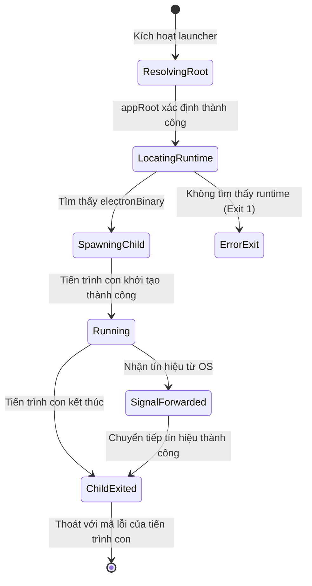

# Data Model: Khởi tạo dự án và Nền tảng phát triển (001-project-init)

Mô hình dữ liệu và các thực thể logic phục vụ tính năng khởi tạo dự án, quản lý cấu hình, phân tích dòng lệnh và ranh giới đóng gói biên dịch (Task 1).

---

## 1. Thực thể Tham số Dòng lệnh (CommandLineArgs)

Đại diện cho các đối số được phân tích từ `process.argv` khi ứng dụng được kích hoạt qua launcher hoặc trực tiếp từ dòng lệnh.

### Thuộc tính

| Trường | Kiểu dữ liệu | Bắt buộc | Mặc định | Quy tắc xác thực | Mô tả |
| :--- | :--- | :---: | :---: | :--- | :--- |
| `mode` | `'manager' \| 'profile'` | Có | `'manager'` | Chỉ chấp nhận một trong hai giá trị | Chế độ khởi chạy của instance |
| `profileId` | `string \| null` | Không | `null` | Ký tự `^[a-z0-9]+(?:-[a-z0-9]+)*$`, độ dài 1..64 | Mã định danh profile khi `mode === 'profile'` |
| `rawArgs` | `string[]` | Có | `[]` | Mảng chuỗi | Toàn bộ danh sách đối số gốc chưa qua xử lý |
| `isPackaged` | `boolean` | Có | `false` | Boolean | Cờ xác định ứng dụng chạy ở chế độ dev hay đóng gói |

### Quy tắc xác thực (Validation Rules)

1. Nếu cờ `--manager` xuất hiện, `mode` được đặt thành `'manager'`.
2. Nếu cờ `--profile <id>` xuất hiện:
   - `<id>` không được rỗng.
   - `<id>` phải tuân thủ định dạng slug an toàn, không chứa ký tự điều khiển, dấu nháy hoặc đường dẫn tương đối (`..`).
   - `mode` được đặt thành `'profile'`, và `profileId` lưu giá trị `<id>`.
3. Không được phép cung cấp đồng thời cả `--manager` và `--profile <id>`. Trường hợp vi phạm phải trả về lỗi phân tích và mã thoát khác 0.
4. Mọi cờ lạ không nằm trong danh mục hỗ trợ phải cảnh báo và dừng thực thi với mã lỗi 1.

---

## 2. Thực thể Cấu hình Đóng gói (BuildOutputTarget)

Đại diện cho các mục tiêu biên dịch trong kịch bản `scripts/build.mjs`.

### Thuộc tính

| Trường | Kiểu dữ liệu | Giá trị hợp lệ | Mô tả |
| :--- | :--- | :--- | :--- |
| `name` | `string` | `'main'`, `'preload'`, `'renderer'` | Tên định danh phân vùng build |
| `entryPoint` | `string` | Đường dẫn tệp `.ts` tương đối | Tệp mã nguồn nguồn gốc |
| `outfile` | `string` | Đường dẫn tệp `.js` trong `dist/` | Tệp bundle đích |
| `platform` | `'node' \| 'browser'` | Target nền tảng esbuild | Môi trường chạy |
| `format` | `'cjs' \| 'esm' \| 'iife'` | Định dạng module | Chuẩn xuất module |
| `external` | `string[]` | Danh sách package | Các module không được bundle gộp (như `electron`) |
| `sandboxSafe` | `boolean` | `true \| false` | Đảm bảo không chứa require rò rỉ |

### Ma trận cấu hình mục tiêu

```typescript
export interface BuildTargetConfig {
  entryPoints: string[];
  outdir?: string;
  outfile?: string;
  platform: 'node' | 'browser';
  format: 'cjs' | 'esm';
  bundle: boolean;
  external?: string[];
  sourcemap: boolean;
}
```

---

## 3. Thực thể Trạng thái Tiến trình Con (LauncherProcessState)

Đại diện cho vòng đời tiến trình được sinh ra bởi script `bin/zaloview.js`.

### Thuộc tính

| Trường | Kiểu dữ liệu | Mô tả |
| :--- | :--- | :--- |
| `appRoot` | `string` | Đường dẫn tuyệt đối tới thư mục gốc của ứng dụng |
| `electronBinary` | `string` | Đường dẫn tới binary thực thi Electron |
| `childPid` | `number \| undefined` | PID của tiến trình Electron đang chạy |
| `exitCode` | `number \| null` | Mã thoát trả về từ tiến trình con |
| `exitSignal` | `string \| null` | Tín hiệu kết thúc tiến trình (ví dụ `SIGINT`, `SIGTERM`) |

### Chuyển đổi trạng thái (State Transitions)


