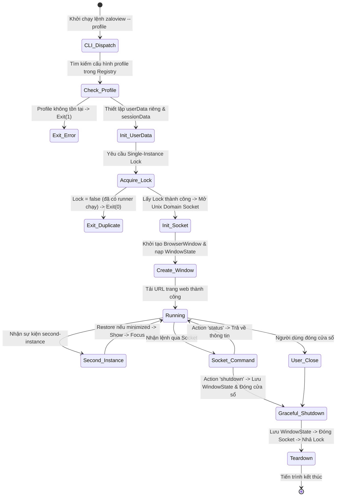

# Data Model: Nền tảng Runner và Quản lý Dữ liệu Phiên

**Feature**: `002-runner-data-platform`
**Date**: 2026-09-12
**Status**: Completed

---

## 1. Thực thể Cấu hình (Configuration Entities)

### 1.1. `XPathConfig`
Định nghĩa thiết lập cho bộ theo dõi nội dung trang web (DOM observer):

```typescript
interface XPathConfig {
  selector: string; // Chuỗi XPath selector. Nếu rỗng -> tắt observer
  mode: 'badge_count' | 'text_content' | 'existence'; // Chế độ so sánh
  pollIntervalMs: number; // Chu kỳ quét dự phòng (ms), số nguyên từ 1000 đến 60000, mặc định 3000
}
```

**Quy tắc xác thực (Validation Rules)**:
- `selector`: Chuỗi ký tự, cho phép rỗng. Nếu không rỗng, phải có độ dài <= 1000 ký tự.
- `mode`: Bắt buộc thuộc một trong ba giá trị enum: `'badge_count'`, `'text_content'`, `'existence'`.
- `pollIntervalMs`: Số nguyên (Integer), không phải NaN, thỏa mãn `1000 <= pollIntervalMs <= 60000`.

---

### 1.2. `DesktopIntegrationConfig`
Định nghĩa các cờ kích hoạt tích hợp với hệ thống desktop Linux:

```typescript
interface DesktopIntegrationConfig {
  flashTaskbar: boolean; // Nhấp nháy thanh tác vụ khi có cảnh báo mới
  showTaskbarBadge: boolean; // Hiển thị số lượng tin chưa đọc trên taskbar/dock
  minimizeToTray: boolean; // Thu nhỏ vào khay hệ thống khi bấm nút đóng (mặc định tắt: false)
  showDesktopNotification: boolean; // Bật thông báo native popup
  createDesktopShortcut: boolean; // Tự động tạo tệp .desktop trong menu ứng dụng
}
```

**Quy tắc xác thực (Validation Rules)**:
- Tất cả các trường bắt buộc phải là kiểu `boolean` tường minh (`true` hoặc `false`), không chấp nhận chuỗi dạng `"true"` hay số `1`/`0`.

---

### 1.3. `Profile`
Thực thể đại diện cho cấu hình hoàn chỉnh của một tài khoản/website độc lập:

```typescript
interface Profile {
  id: string; // Định danh bất biến, duy nhất dạng slug
  name: string; // Tên hiển thị người dùng đặt
  url: string; // Địa chỉ trang web chuẩn HTTP(S)
  iconPath?: string; // Đường dẫn biểu tượng đã được chuẩn hóa
  userAgent?: string; // Chuỗi định danh User-Agent tùy biến (nếu có)
  xpathConfig: XPathConfig; // Cấu hình XPath observer
  desktopConfig: DesktopIntegrationConfig; // Cấu hình tích hợp desktop
  createdAt: string; // Mốc thời gian tạo (ISO 8601 UTC)
  updatedAt: string; // Mốc thời gian cập nhật gần nhất (ISO 8601 UTC)
}
```

**Quy tắc xác thực (Validation Rules)**:
- `id`: Bắt buộc, không thay đổi sau khi tạo. Chuỗi ký tự độ dài từ 1 đến 64 ký tự, chỉ chứa chữ thường, số và dấu gạch nối, định dạng khớp biểu thức chính quy: `/^[a-z0-9]+(?:-[a-z0-9]+)*$/`. Tuyệt đối cấm ký tự duyệt thư mục như `..`, `/`, `\`, khoảng trắng hoặc ký tự điều khiển.
- `name`: Chuỗi ký tự không rỗng sau khi trim, độ dài từ 1 đến 120 ký tự. Không chứa ký tự điều khiển hệ thống (`\r`, `\n`, `\0`).
- `url`: Chuỗi URL hợp lệ có giao thức bắt buộc là `http:` hoặc `https:`. Tuyệt đối không chứa thông tin xác thực nhúng trong URL (`user:pass@host`).
- `iconPath`: Nếu có, phải là đường dẫn tệp tuyệt đối hợp lệ và tệp tồn tại trên đĩa.
- `createdAt`, `updatedAt`: Chuỗi thời gian chuẩn ISO 8601 hợp lệ (`YYYY-MM-DDTHH:mm:ss.sssZ`).

---

### 1.4. `ProfileRegistry`
Định dạng tệp lưu trữ tập trung danh sách cấu hình (`$XDG_CONFIG_HOME/zaloview/profiles.json`):

```typescript
interface ProfileRegistry {
  schemaVersion: 1; // Phiên bản cấu trúc dữ liệu
  profiles: Profile[]; // Danh sách các profile hiện có
}
```

**Quy tắc xác thực (Validation Rules)**:
- `schemaVersion`: Bắt buộc phải là số nguyên `1`. Nếu đọc được giá trị khác 1, hệ thống từ chối nạp để tránh làm sai lệch dữ liệu.
- `profiles`: Mảng các đối tượng `Profile`. Không được phép có hai profile trùng `id`.

---

## 2. Thực thể Trạng thái Runtime (Runtime State Entities)

### 2.1. `WindowState`
Lưu trữ trạng thái không gian của cửa sổ trong thư mục userData của từng runner (`window-state.json`):

```typescript
interface WindowState {
  x?: number; // Tọa độ X trên màn hình
  y?: number; // Tọa độ Y trên màn hình
  width: number; // Chiều rộng cửa sổ (pixels, tối thiểu 400, mặc định 1024)
  height: number; // Chiều cao cửa sổ (pixels, tối thiểu 300, mặc định 768)
  isMaximized: boolean; // Cờ trạng thái phóng to toàn màn hình (mặc định false)
}
```

**Quy tắc xác thực & Khôi phục**:
- `width`: Số nguyên dương, `width >= 400`.
- `height`: Số nguyên dương, `height >= 300`.
- `x`, `y`: Nếu được xác định, phải được kiểm tra giao cắt với hình chữ nhật làm việc của các màn hình hiện kết nối (`screen.getAllDisplays()`). Nếu nằm ngoài vùng khả dụng, tự động đưa về trung tâm màn hình chính.
- Khi `isMaximized === true`, giá trị `width` và `height` vẫn lưu kích thước thông thường (normal bounds) để khi người dùng unmaximize, cửa sổ trở về kích thước hợp lý.

---

### 2.2. `PermissionStore`
Lưu trữ quyết định cấp quyền thiết bị theo từng nguồn trang web trong userData của runner (`permissions.json`):

```typescript
type PermissionName = 'media' | 'geolocation' | 'notifications' | 'clipboard-read';

interface PermissionRecord {
  granted: boolean;
  updatedAt: string; // ISO 8601
}

interface PermissionStore {
  [origin: string]: {
    [permission: string]: PermissionRecord;
  };
}
```

**Quy tắc xử lý**:
- `origin`: Chuỗi định danh nguồn gốc chuẩn hóa (ví dụ `https://chat.zalo.me`).
- Quyết định được phân tách theo từng origin, không cho phép một trang web kế thừa quyền của trang web khác.

---

### 2.3. `RunnerControlMessage`
Cấu trúc thông điệp trao đổi qua Unix Domain Socket giữa Manager và Runner:

```typescript
// Định dạng yêu cầu (Request)
interface RunnerControlRequest {
  requestId: string; // UUID v4 hoặc chuỗi ngẫu nhiên duy nhất
  action: 'status' | 'shutdown'; // Lệnh yêu cầu
  params?: Record<string, unknown>; // Tham số bổ sung nếu có
}

// Định dạng dữ liệu phản hồi trạng thái
interface RunnerStatusData {
  status: 'starting' | 'running' | 'error';
  profileId: string;
  url: string;
  pid: number;
  uptimeSeconds: number;
  windowState: WindowState;
}

// Định dạng phản hồi (Response)
interface RunnerControlResponse {
  requestId: string; // Khớp với requestId trong yêu cầu
  success: boolean; // Kết quả thực thi
  data?: RunnerStatusData | Record<string, unknown>; // Dữ liệu trả về khi thành công
  error?: string; // Thông báo lỗi khi thất bại
}
```

**Giới hạn kỹ thuật**:
- Mỗi thông điệp kết thúc bằng ký tự xuống dòng `\n`.
- Kích thước thông điệp tối đa: 65,536 bytes (64 KiB).
- Timeout phản hồi mặc định: 5000 ms.

---

## 3. Biểu đồ Chuyển đổi Trạng thái Vòng đời (State Transitions)

### 3.1. Vòng đời Runner Process


