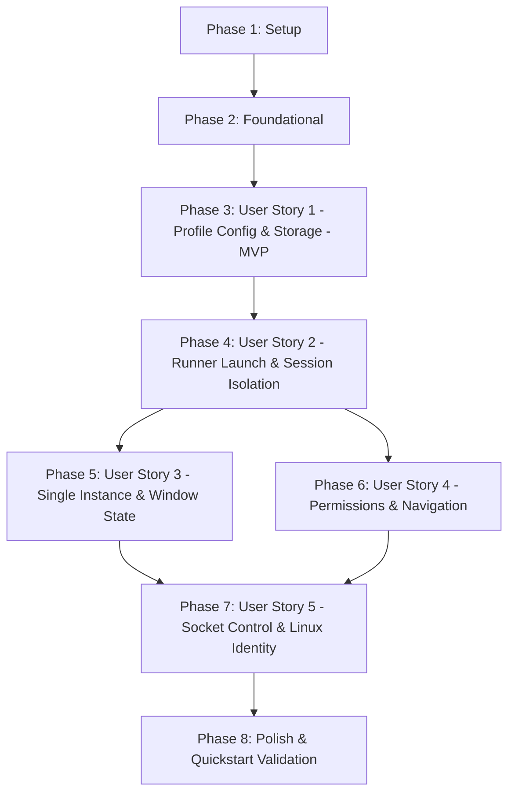

# Tasks: Nền tảng Runner và Quản lý Dữ liệu Phiên (002-runner-data-platform)

**Branch**: `002-runner-data-platform`
**Spec**: [spec.md](spec.md) | **Plan**: [plan.md](plan.md)
**Data Model**: [data-model.md](data-model.md) | **Quickstart**: [quickstart.md](quickstart.md)

---

## Phase 1: Setup (Shared Infrastructure)

**Purpose**: Thiết lập các kiểu dữ liệu dùng chung và công cụ hỗ trợ kiểm thử môi trường XDG cô lập.

- [X] T001 Cập nhật định nghĩa kiểu dữ liệu trong `src/shared/types.ts` bao gồm `Profile`, `ProfileRegistry` (schemaVersion: 1), `XPathConfig`, `DesktopIntegrationConfig`, `WindowState`, `PermissionStore`, và `RunnerControlMessage` theo đúng hợp đồng trong `specs/002-runner-data-platform/data-model.md`.
- [X] T002 [P] Tạo bộ công cụ tiện ích kiểm thử môi trường XDG cô lập (thư mục tạm cho config và data) trong `tests/test-utils.ts`.

---

## Phase 2: Foundational (Blocking Prerequisites)

**Purpose**: Hạ tầng lõi về phân giải đường dẫn XDG và ghi tệp nguyên tử POSIX (bắt buộc hoàn thành trước khi triển khai các user story).

**⚠️ CRITICAL**: Không thể bắt đầu các User Story khi chưa hoàn thành giai đoạn này.

- [X] T003 Triển khai bộ phân giải đường dẫn XDG (`resolveConfigDir`, `resolveDataDir`, `resolveRegistryPath`, `resolveProfileDataDir`, `resolveWindowStatePath`, `resolveSocketPath`) tuân thủ FreeDesktop XDG Base Directory trong `src/main/xdg-paths.ts`.
- [X] T004 [P] Triển khai module ghi tệp nguyên tử (`atomicWriteFile`) sử dụng tệp tạm thời `.tmp.<pid>.<timestamp>`, `fs.fsyncSync` và `fs.renameSync` với phân quyền `0600` cho tệp và `0700` cho thư mục trong `src/main/atomic-writer.ts`.

**Checkpoint**: Nền tảng tệp và đường dẫn XDG hoàn tất — sẵn sàng triển khai các User Story.

---

## Phase 3: User Story 1 - Quản lý cấu hình Profile và bảo toàn dữ liệu (Priority: P1) 🎯 MVP

**Goal**: Lưu trữ danh sách profile trong `profiles.json` tại `XDG_CONFIG_HOME`, kiểm tra schema version và validate toàn diện các trường, ghi nguyên tử, bảo toàn tệp gốc khi JSON bị lỗi cú pháp, và lưu trữ `window-state.json` độc lập.

**Independent Test**: Chạy `npm test tests/profile-manager.test.ts` và `npm test tests/profile-storage.test.ts`, xác nhận tạo/sửa/xóa profile hợp lệ, bắt lỗi cú pháp JSON và giữ nguyên tệp hỏng mà không ghi đè rỗng.

### Tests for User Story 1 ⚠️
- [X] T005 [P] [US1] Viết unit tests kiểm tra validation schema, schemaVersion check, chặn path traversal trong ID, và cơ chế kháng lỗi hỏng JSON (ProfileRegistryCorruptError) trong `tests/profile-manager.test.ts`.
- [X] T006 [P] [US1] Viết unit tests kiểm tra ghi nguyên tử (atomic write), quyền riêng tư `0600`/`0700`, và đọc/ghi độc lập `window-state.json` trong `tests/profile-storage.test.ts`.

### Implementation for User Story 1
- [X] T007 [US1] Triển khai bộ xác thực cấu hình `validateProfile`, `validateXPathConfig` (selector <= 1000 ký tự; mode thuộc 'badge_count' | 'text_content' | 'existence'; pollIntervalMs nguyên 1000..60000), `validateDesktopConfig` (booleans), `validateProfileId` (slug regex `/^[a-z0-9]+(?:-[a-z0-9]+)*$/`, 1-64 ký tự, cấm `..`, `/`), và hàm sinh slug tiếng Việt trong `src/main/profile-validator.ts`.
- [X] T008 [US1] Triển khai class `ProfileManager` với các phương thức `loadRegistry`, `getProfile`, `createProfile`, `updateProfile`, `deleteProfile`, `loadWindowState`, `saveWindowState` theo hợp đồng `specs/002-runner-data-platform/contracts/profile-storage.md` trong `src/main/profile-manager.ts`.

**Checkpoint**: User Story 1 hoàn thành — quản lý cấu hình và tính toàn vẹn dữ liệu được kiểm thử độc lập.

---

## Phase 4: User Story 2 - Khởi chạy Runner độc lập và cách ly phiên duyệt web (Priority: P1)

**Goal**: Khởi chạy cửa sổ native cho từng profile qua lệnh `./bin/zaloview.js --profile <id>`, không có thanh URL/menu, với `userData` và session partition `persist:zaloview_<id>` riêng biệt.

**Independent Test**: Khởi chạy đồng thời hai profile khác nhau từ CLI, xác nhận hai thư mục userData riêng được tạo và phiên duyệt web (cookies, storage) hoàn toàn cách ly.

### Tests for User Story 2 ⚠️
- [X] T009 [P] [US2] Viết kiểm thử tích hợp kiểm tra phân tách thư mục `userData` và cấu hình session partition theo profile trong `tests/runner-isolation.test.ts`.

### Implementation for User Story 2
- [X] T010 [US2] Triển khai module `WindowService` (`createRunnerWindow`) tạo `BrowserWindow` với native frame, ẩn menu bar (`autoHideMenuBar: true`), partition `persist:zaloview_<id>`, `sandbox: true`, `contextIsolation: true`, `nodeIntegration: false` theo hợp đồng trong `src/main/window-service.ts`.
- [X] T011 [US2] Cập nhật `src/main/index.ts` điều phối chế độ `--profile <id>`, nạp cấu hình profile từ `ProfileManager`, thiết lập `userData` về `$XDG_DATA_HOME/zaloview/profiles/<id>` trước `app.whenReady()`, và tải URL profile qua `win.loadURL(profile.url)`.

**Checkpoint**: User Story 2 hoàn thành — mở được profile độc lập, phiên làm việc được lưu trữ và cách ly.

---

## Phase 5: User Story 3 - Khóa đơn phiên theo Profile và khôi phục trạng thái cửa sổ (Priority: P2)

**Goal**: Đảm bảo mỗi profile chỉ chạy 1 instance, mở lại profile đang chạy sẽ khôi phục/focus cửa sổ hiện có, ghi nhớ kích thước/tọa độ và khôi phục trạng thái phóng to (maximized) an toàn với đa màn hình.

**Independent Test**: Chạy thử mở profile A hai lần, xác minh instance thứ hai thoát với mã 0 và cửa sổ ban đầu được restore/show/focus; thu nhỏ cửa sổ hoặc đổi kích thước và mở lại để kiểm tra khôi phục tọa độ.

### Tests for User Story 3 ⚠️
- [X] T012 [P] [US3] Viết unit tests kiểm tra thuật toán kẹp tọa độ màn hình (screen boundary clamping) và khôi phục normal bounds khi maximized trong `tests/window-state.test.ts`.

### Implementation for User Story 3
- [X] T013 [US3] Triển khai module `ScreenUtils` kiểm tra giao cắt tọa độ cửa sổ với `screen.getAllDisplays()` và kẹp tọa độ về trung tâm màn hình chính nếu nằm ngoài vùng khả dụng trong `src/main/screen-utils.ts`.
- [X] T014 [US3] Tích hợp cơ chế `app.requestSingleInstanceLock()` theo từng profile, xử lý sự kiện `second-instance` (restore nếu `isMinimized`, `show`, `focus`), và debounce 300ms lưu normal bounds khi `resize`/`move`/`close` trong `src/main/window-service.ts` và `src/main/index.ts`.

**Checkpoint**: User Story 3 hoàn thành — single-instance và quản lý kích thước cửa sổ hoạt động mượt mà.

---

## Phase 6: User Story 4 - Kiểm soát quyền truy cập phần cứng và an toàn điều hướng (Priority: P3)

**Goal**: Kiểm soát quyền camera/microphone theo origin với xác nhận từ người dùng, lưu trữ quyết định trong `permissions.json`, từ chối quyền không làm hỏng chat, và chặn điều hướng ngoài qua `shell.openExternal`.

**Independent Test**: Chạy `npm test tests/permissions.test.ts`, kiểm tra cấp quyền và từ chối quyền theo origin, xác nhận các liên kết ngoài kích hoạt mở trình duyệt hệ thống.

### Tests for User Story 4 ⚠️
- [X] T015 [P] [US4] Viết unit tests kiểm tra lưu trữ quyết định quyền thiết bị theo origin và logic phê duyệt/từ chối trong `tests/permissions.test.ts`.

### Implementation for User Story 4
- [X] T016 [US4] Triển khai `PermissionManager` lưu trữ và đọc các bản ghi quyền thiết bị theo origin trong `$XDG_DATA_HOME/zaloview/profiles/<id>/permissions.json` trong `src/main/permission-manager.ts`.
- [X] T017 [US4] Đăng ký các handler bảo mật trên session (`setPermissionCheckHandler`, `setPermissionRequestHandler`) và WebContents (`will-navigate`, `setWindowOpenHandler` chặn tạo cửa sổ con và mở URL ngoài bằng `shell.openExternal`) trong `src/main/window-service.ts`.

**Checkpoint**: User Story 4 hoàn thành — quyền thiết bị và ranh giới điều hướng an toàn tuyệt đối.

---

## Phase 7: User Story 5 - Điều khiển vòng đời và kênh trạng thái tiến trình (Priority: P3)

**Goal**: Mở Unix domain socket cục bộ hỗ trợ truy vấn `status` và lệnh `shutdown` an toàn, dọn dẹp stale socket, và thiết lập Linux window identity (`app.setDesktopName`).

**Independent Test**: Chạy `npm test tests/runner-control.test.ts`, gửi lệnh status và shutdown qua socket giả lập, kiểm tra timeout và dọn dẹp stale socket khi nhận `ECONNREFUSED`.

### Tests for User Story 5 ⚠️
- [X] T018 [P] [US5] Viết unit tests kiểm tra giao thức Unix domain socket (Line-delimited JSON, giới hạn 64 KiB buffer, timeout 5s, và khôi phục stale socket) trong `tests/runner-control.test.ts`.

### Implementation for User Story 5
- [X] T019 [US5] Triển khai `RunnerControlServer` xử lý các hành động `status` và `shutdown` với quyền tệp `0600`/`0700`, tự động kiểm tra kết nối để dọn stale socket theo hợp đồng `specs/002-runner-data-platform/contracts/runner-control-socket.md` trong `src/main/runner-control.ts`.
- [X] T020 [US5] Tích hợp cấu hình Linux identity `app.setDesktopName('zaloview-' + profile.id)` và khởi động/dọn dẹp `RunnerControlServer` vào vòng đời ứng dụng trong `src/main/index.ts`.

**Checkpoint**: User Story 5 hoàn thành — kênh điều khiển IPC cục bộ và định danh Linux sẵn sàng cho Dashboard Manager.

---

## Phase 8: Polish & Cross-Cutting Concerns

**Purpose**: Đảm bảo chất lượng toàn diện, typecheck nghiêm ngặt, kiểm thử toàn bộ và chạy kịch bản quickstart.

- [X] T021 [P] Kiểm tra tính hợp lệ toàn bộ kiểu dữ liệu TypeScript bằng `npm run typecheck`.
- [X] T022 [P] Chạy toàn bộ bộ kiểm thử tự động bằng `npm test` đảm bảo 100% tests vượt qua.
- [X] T023 Thực hiện kiểm chứng đầu cuối thủ công các kịch bản trong `specs/002-runner-data-platform/quickstart.md` với launcher `./bin/zaloview.js --profile <id>`.

---

## Dependencies & Execution Order

### Phase Dependencies

### User Story Dependencies

- **US1 (P1)**: Bắt đầu ngay sau Phase 2 (Foundational). Là MVP nền tảng lưu trữ cấu hình.
- **US2 (P1)**: Bắt đầu sau khi US1 hoàn tất (`ProfileManager` sẵn sàng cung cấp cấu hình cho Runner).
- **US3 (P2)**: Bắt đầu sau khi US2 hoàn tất (Cửa sổ Runner đã được khởi tạo cơ bản).
- **US4 (P3)**: Bắt đầu sau khi US2 hoàn tất (Cửa sổ Runner có session để đăng ký permission handlers).
- **US5 (P3)**: Bắt đầu sau khi US3 và US4 hoàn tất (Cửa sổ và vòng đời Runner đã đầy đủ trạng thái).

### Parallel Opportunities

- **Phase 1**: `T002` có thể làm song song với `T001`.
- **Phase 2**: `T004` có thể làm song song với `T003`.
- **Phase 3**: `T005` và `T006` có thể viết song song; `T007` có thể làm song song với `T008` (phần định nghĩa schema).
- **Phase 5 & Phase 6**: Sau khi Phase 4 hoàn tất, User Story 3 và User Story 4 có thể triển khai song song nếu có nhiều nhân sự.
- **Phase 8**: `T021` và `T022` có thể chạy song song.

---

## Implementation Strategy

### MVP First (User Story 1 & 2)
1. Hoàn thành Phase 1 & Phase 2 (Cấu trúc dữ liệu, XDG paths, atomic writer).
2. Hoàn thành Phase 3 (ProfileManager & Storage validation).
3. Hoàn thành Phase 4 (Khởi chạy Runner với session partition độc lập).
4. **Kiểm tra MVP**: Chạy `./bin/zaloview.js --profile test-profile`, xác minh cửa sổ mở đúng URL và lưu session.

### Incremental Delivery
1. Bổ sung User Story 3: Single-instance lock và khôi phục kích thước cửa sổ.
2. Bổ sung User Story 4: Kiểm soát quyền camera/mic và liên kết ngoài.
3. Bổ sung User Story 5: Kênh Unix domain socket điều khiển và định danh Linux `app.setDesktopName`.
4. Polish: Typecheck, toàn bộ test suite và nghiệm thu theo tiêu chí Phase 1 trong `docs/phased_implementation_plan.md`.
