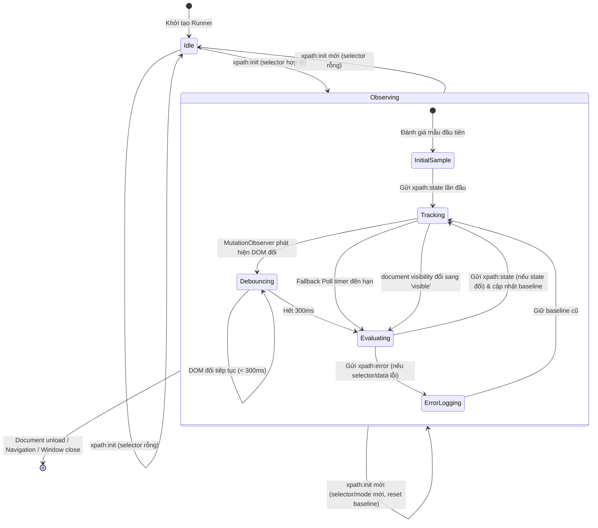

# Data Model: XPath Observer và Quản lý Trạng thái Quan sát (Phase 2)

**Branch**: `003-xpath-observer-state` | **Date**: 2026-09-12 | **Spec**: [spec.md](./spec.md)

---

## 1. Thực thể Dữ liệu (Core Entities)

### 1.1. `XPathObservationMode` (Enum)
Chế độ quan sát DOM cho bộ chọn XPath.

```typescript
export type XPathObservationMode = 'existence' | 'badge_count' | 'text_content';
```

- `existence`: Kiểm tra sự tồn tại của phần tử trong DOM (0 hoặc 1).
- `badge_count`: Trích xuất số lượng thông báo dưới dạng số nguyên không âm (hỗ trợ định dạng `99+`).
- `text_content`: Trích xuất chuỗi văn bản nội dung của phần tử sau khi cắt khoảng trắng (`trim`).

---

### 1.2. `XPathConfig`
Cấu hình theo dõi XPath thuộc về từng Profile.

```typescript
export interface XPathConfig {
  /** Chuỗi biểu thức XPath. Nếu rỗng (''), toàn bộ observer sẽ bị tắt. Tối đa 1000 ký tự. */
  selector: string;
  /** Chế độ theo dõi dữ liệu */
  mode: XPathObservationMode;
  /** Chu kỳ quét định kỳ dự phòng (ms), phạm vi 1000..60000, mặc định 3000 */
  pollIntervalMs: number;
}
```

**Quy tắc hợp lệ (Validation Rules)**:
- `selector`: Chuỗi ký tự, độ dài từ 0 đến 1000 ký tự.
- `mode`: Một trong 3 giá trị: `'existence'`, `'badge_count'`, `'text_content'`.
- `pollIntervalMs`: Số nguyên, giá trị từ 1000 đến 60000 ms. Mặc định 3000 ms nếu không truyền.

---

### 1.3. `XPathObservationState`
Ảnh chụp trạng thái DOM tại một thời điểm quan sát, truyền từ Preload sang Main Process qua IPC `xpath:state`.

```typescript
export interface XPathObservationState {
  /** Chế độ quan sát đang thực thi */
  mode: XPathObservationMode;
  /** Có tìm thấy phần tử trong DOM hay không */
  hasElement: boolean;
  /** Số lượng tin nhắn/huy hiệu (áp dụng cho badge_count, mặc định 0 nếu không match hoặc ở chế độ khác) */
  count: number;
  /** Nội dung văn bản xem trước (tối đa 500 ký tự) */
  text: string;
  /** Cờ đánh dấu có thay đổi đủ điều kiện kích hoạt cảnh báo chú ý hay không */
  changedForAlert: boolean;
  /** Dấu thời gian ghi nhận trạng thái (Unix timestamp ms) */
  timestamp: number;
}
```

---

### 1.4. `XPathBaselineRecord`
Bản ghi mẫu cơ sở gần nhất được lưu trong bộ nhớ để làm mốc so sánh với các lần quan sát tiếp theo.

```typescript
export interface XPathBaselineRecord {
  /** Có phần tử ở mẫu trước hay không */
  hasElement: boolean;
  /** Số lượng ở mẫu trước */
  count: number;
  /** Toàn bộ nội dung văn bản gốc ở mẫu trước (không bị cắt ngắn 500 ký tự) */
  fullText: string;
  /** Dấu thời gian cập nhật baseline gần nhất */
  updatedAt: number;
}
```

**Bảng Chân trị Chuyển đổi Trạng thái và Điều kiện Cảnh báo (`changedForAlert`)**:

| Chế độ (`mode`) | Trạng thái Mẫu trước (`Baseline`) | Trạng thái Mẫu hiện tại (`Current`) | `changedForAlert` | Hành vi Cập nhật Baseline |
| :--- | :--- | :--- | :--- | :--- |
| `existence` | `hasElement = false` | `hasElement = true` | **`true`** | Cập nhật baseline `hasElement = true` |
| `existence` | `hasElement = true` | `hasElement = true` (text đổi) | `false` | Cập nhật baseline fullText |
| `existence` | `hasElement = true` | `hasElement = false` | `false` | Cập nhật baseline `hasElement = false` |
| `badge_count` | `count = 0` (hoặc rỗng) | `count = 3` (tăng) | **`true`** | Cập nhật baseline `count = 3` |
| `badge_count` | `count = 5` | `count = 3` (giảm) | `false` | Cập nhật baseline `count = 3` |
| `badge_count` | `count = 3` | `count = 4` (tăng) | **`true`** | Cập nhật baseline `count = 4` |
| `badge_count` | `count = 4` | `hasElement = false` | `false` | Cập nhật baseline `count = 0, hasElement = false` |
| `text_content` | `fullText = ""` | `fullText = "A"` | **`true`** | Cập nhật baseline `fullText = "A"` |
| `text_content` | `fullText = "A"` | `fullText = "B"` | **`true`** | Cập nhật baseline `fullText = "B"` |
| `text_content` | `fullText = "A"` | `fullText = ""` | `false` | Cập nhật baseline `fullText = ""` |
| `text_content` | `fullText = "A"` | `fullText = "A"` | `false` | Không đổi |

---

### 1.5. `XPathEvaluationStatus` (Enum) & `XPathEvaluationResult`
Kết quả đánh giá XPath (dùng chung cho cả bộ trích xuất nội bộ và lệnh thử nghiệm thủ công `test-xpath`).

```typescript
export type XPathEvaluationStatus = 
  | 'match'
  | 'no_match'
  | 'invalid_selector'
  | 'invalid_data'
  | 'error';

export interface XPathEvaluationResult {
  /** Trạng thái đánh giá */
  status: XPathEvaluationStatus;
  /** Bộ chọn XPath đã sử dụng */
  selector: string;
  /** Chế độ quan sát đã sử dụng */
  mode: XPathObservationMode;
  /** Có tìm thấy node phần tử hay không */
  hasElement: boolean;
  /** Giá trị số lượng tính được (nếu ở chế độ badge_count hoặc existence) */
  count: number;
  /** Đoạn trích dẫn văn bản (tối đa 500 ký tự) */
  textPreview: string;
  /** Thông điệp lỗi chi tiết (nếu status là invalid_selector, invalid_data, hoặc error) */
  error?: string;
  /** Thời gian thực thi việc đánh giá (ms) */
  executionTimeMs: number;
}
```

---

### 1.6. `XPathTestRequest` & `XPathTestResponse`
Gói tin yêu cầu và kết quả thử nghiệm XPath giữa Main và Preload qua IPC, và giữa Socket Client với Main.

```typescript
export interface XPathTestRequest {
  requestId: string;
  selector: string;
  mode: XPathObservationMode;
}

export interface XPathTestResponse {
  requestId: string;
  success: boolean;
  result?: XPathEvaluationResult;
  error?: string;
}
```

---

## 2. Vòng đời Trạng thái Giám sát (State Lifecycle)


